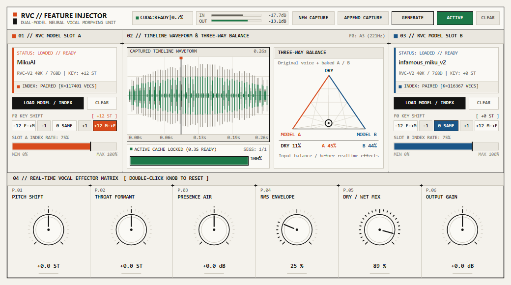
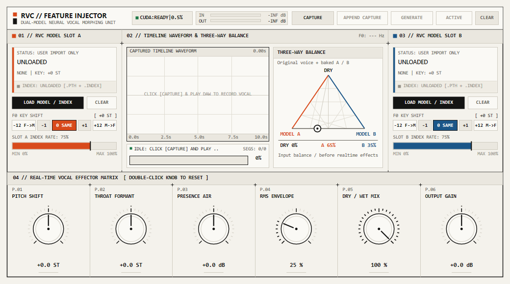
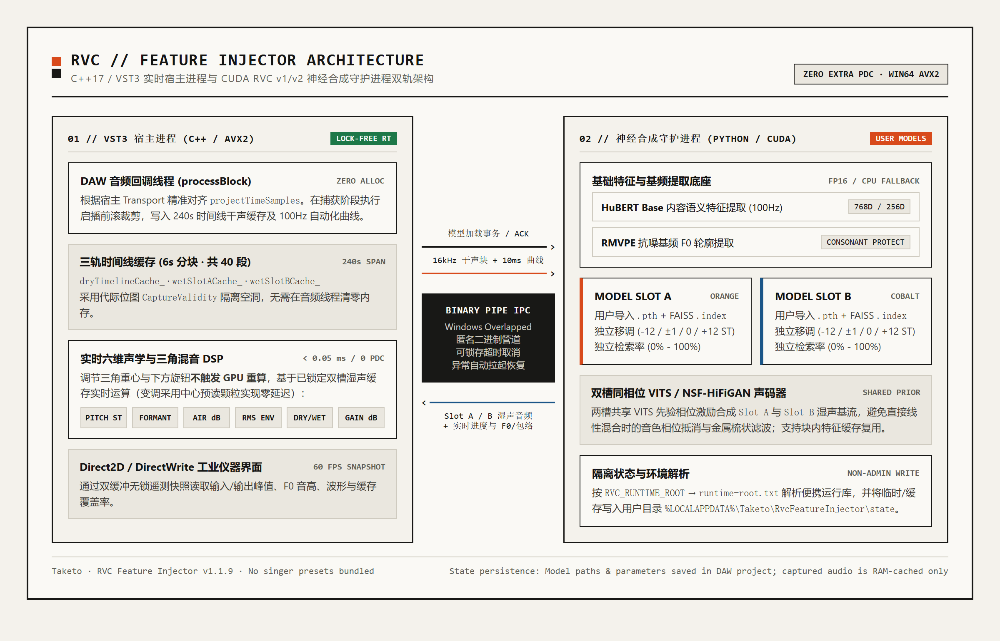
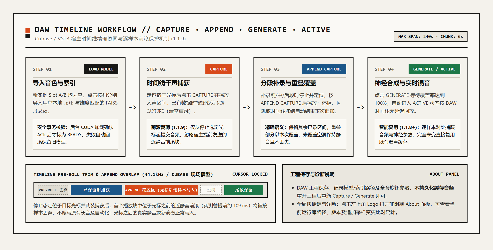

<div align="center">


# RVC Feature Injector

**面向 Windows x64 DAW 的双模型 RVC v1/v2 实时人声特征注入与音色混合 VST3 插件**

`v1.1.9` · `Build 20261111.2` · `Windows x64 / AVX2` · `Zero Extra PDC`

[下载最新版](https://github.com/met-tk/RvcFeatureInjector/releases/latest) · [核心特性](#核心特性) · [架构与原理](#架构与原理) · [工作流指南](#daw-工作流指南) · [从源码构建](#从源码构建与测试)

</div>

---



> 注：上图为加载用户本地 `.pth` 与 `.index` 双模型后执行捕获、生成并进入 `ACTIVE` 实时混合回放的界面预览。本仓库及安装包**不附带任何歌姬模型或内置音色预设**，所有模型均由用户自行导入。

RVC Feature Injector 是一款专为 Cubase 等宿主环境设计的 VST3 人声转换与音色混合插件。插件采用 **离线神经合成基流 + 零延迟实时后级塑形** 的双轨架构：先沿 DAW 时间线捕获原轨干声，由后台 CUDA 守护进程驱动 HuBERT / RMVPE / FAISS 与双槽同相位 VITS 声码器预生成对齐缓存，随后在宿主音频线程中以 `< 0.05 ms` 开销实时混合 **Dry / Model A / Model B** 三方音色，并支持零额外 PDC 延迟的音高、共振峰、空气感与动态响应调节。

---

## 核心特性

- **双槽同相位 RVC v1/v2 神经合成**
  - Slot A 与 Slot B 独立加载用户 `.pth` 权重及 FAISS `.index` 检索文件，严格校验模型与索引向量维度（拒绝空索引与非 L2 索引），加载经后台事务 ACK 确认后才标记为可用。
  - 双槽共享 VITS 先验相位激励进行神经合成，避免直接线性混合不同声码器输出时的相位抵消与金属感。
  - 支持单槽独立八度/半音移调（`-12 / -1 / 0 / +1 / +12 ST`）及独立索引检索比例（`0% - 100%`）。
- **三方重心混合与零延迟实时效果矩阵**
  - 居中三角平衡区实时调节 **DRY（原声）/ MODEL A / MODEL B** 权重配比。
  - 底部六枚实机旋钮全量在 C++ 音频线程无锁实时计算，调节旋钮或写入自动化**不会触发 GPU 重算**：
    - `P.01 PITCH SHIFT`（`-12.0 ~ +12.0 ST`，基于缓存中心预读颗粒变调，保持宿主零额外 PDC）
    - `P.02 THROAT FORMANT`（`-6.0 ~ +6.0 ST`，四频段声道共振峰形态移位）
    - `P.03 PRESENCE AIR`（`-6.0 ~ +6.0 dB`，高频空气感与临场激励）
    - `P.04 RMS ENVELOPE`（`0% ~ 100%`，滑动窗口响度包络跟随，参考捕获干声动态）
    - `P.05 DRY / WET MIX`（`0% ~ 100%`，与注入深度双向联动）
    - `P.06 OUTPUT GAIN`（`-12.0 ~ +12.0 dB`，输出电平修整）
  - 宿主参数列表额外提供标准 RVC 语义的 `Consonant Protect`（`0.0` 强保护 ~ `0.5` 关闭，默认 `0.33`）。
- **DAW 时间线精准对齐与追加补录（1.1.9）**
  - 单实例支持最多 **240 秒** 捕获跨度（含中间空洞，按 6 秒分块缓存），同步记录 **10 ms / 100 Hz** 神经参数自动化曲线。
  - 支持 `APPEND CAPTURE` 分段补录前段、中段或尾段；宿主停播、回跳、跳转或时间线冻结会自动结束本次追加。
  - **1.1.9 启播前滚裁剪**：针对 Cubase 停止后重新播放时提前发送近静音前滚块的问题，插件仅从停止时选定的光标位置起提交音频与自动化，跨边界块按采样精准裁剪，避免覆写已有长音。
  - **1.1.8+ 湿声缓存智能复用**：追加捕获后若逐样本输入、有效区间、自动化与模型参数完全一致，按下 `GENERATE` 将直接复用已有湿声缓存。
- **工业级 Direct2D 仪器界面与非阻塞诊断**
  - 原生 Win32 + Direct2D / DirectWrite 渲染，`/MT` 静态链接 CRT，确保宿主扫描插件时不依赖系统全局 VC++ 运行库。
  - 点击左上角 Logo 图标可开启非阻塞 **About** 面板，查看版本、Build、运行库路径、双槽状态以及最近一次 `APPEND` 的样本变更比对统计（`Esc` 或点击外部关闭）。



> 默认空载界面：Slot A 与 Slot B 均为 `UNLOADED`（需用户手动导入 `.pth` 与 `.index`），左上角状态条实时指示 CUDA 守护进程与主机负载。

---

## 架构与原理



1. **宿主实时进程 (`RvcFeatureInjector.vst3`, C++17 / AVX2)**
   - `RvcVst3Plugin` 与 `RvcFeatureInjector` 负责 Steinberg VST3 生命周期、参数自动化、Transport 状态读取、240 秒无锁时间线缓存与 60 FPS 遥测快照。
   - `RvcModelEngine` 通过 Windows Overlapped 匿名二进制管道管理子进程通信，支持超时取消、异常自动恢复与安全路径解析。
2. **后台神经推理守护进程 (`rvc_daemon_worker.py`, Python / CUDA)**
   - 启动时隔离标准输出句柄防止库日志污染二进制协议帧，并将缓存与临时目录重定向至 `%LOCALAPPDATA%\Taketo\RvcFeatureInjector\state`。
   - 加载 `HuBERT Base` 与 `RMVPE` 提取 100 Hz 内容语义与基频轮廓，随后按 chunk ID 缓存特征并在 CUDA 上执行双槽 VITS/NSF-HiFiGAN 合成（无 GPU 时自动回退 CPU）。

---

## DAW 工作流指南



1. **导入模型与索引**：在 Slot A / Slot B 点击 `LOAD MODEL / INDEX` 导入本地 `.pth`（若目录存在唯一匹配的 `.index` 将自动配对，否则需显式选择同维度 L2 FAISS 索引）。
2. **捕获干声 (`CAPTURE` / `NEW CAPTURE`)**：将 Cubase 播放头定位至人声起点，点击 `CAPTURE` 并播放区间；停止播放或点击 `STOP CAP` 结束录入。已有数据时原按钮切换为 `NEW CAPTURE`（点击将清空并重录）。
3. **补录与覆盖 (`APPEND CAPTURE`)**：需要局部重录或补录时，停止并定位到目标位置，点击 `APPEND CAPTURE` 后播放目标区间；停播、回跳或时间线冻结自动收尾。重叠部分以本次录入为准，未覆盖区间与空洞保持原样。
4. **生成与回放 (`GENERATE` -> `ACTIVE`)**：点击 `GENERATE`，待进度条覆盖率达到 `100%` 后自动切换为 `ACTIVE`。此时移动三角重心及底部旋钮即可零延迟实时监听与调节。

> **关于工程保存的重要提示**：DAW 工程会持久化保存模型/索引路径、独立槽位半音移调与全部效果器参数（兼容读取旧版 V1/V2 状态）；**捕获与生成的音频缓存在内存中，不写入工程文件**，重新打开工程后请重新执行一次 `CAPTURE` 与 `GENERATE`。

---

## 安装与运行环境

### 下载与校验说明（Release v1.1.9）

由于完整离线安装程序包含便携 Python、CUDA 依赖及 HuBERT / RMVPE 基础模型（单文件约 **2.77 GiB**），超过 GitHub Releases 单文件 2 GiB 限制，因此 Release 中提供以下两种获取方式：

- **方式一：完整离线安装程序（推荐新手与干净系统使用）**
  1. 在 [Release v1.1.9](https://github.com/met-tk/RvcFeatureInjector/releases/tag/v1.1.9) 下载 `RvcFeatureInjector-1.1.9-Setup.exe.part1` 与 `RvcFeatureInjector-1.1.9-Setup.exe.part2`。
  2. 将两个文件置于同一目录，在 Windows 命令行执行合并命令（无需任何第三方解压软件）：
     ```cmd
     copy /b RvcFeatureInjector-1.1.9-Setup.exe.part1 + RvcFeatureInjector-1.1.9-Setup.exe.part2 RvcFeatureInjector-1.1.9-Setup.exe
     ```
     或使用 PowerShell 校验合并后的 SHA256 是否与 `SHA256SUMS.txt` 一致：
     ```powershell
     Get-FileHash .\RvcFeatureInjector-1.1.9-Setup.exe -Algorithm SHA256
     ```
  3. 关闭 Cubase，以管理员权限运行 `RvcFeatureInjector-1.1.9-Setup.exe`。

- **方式二：纯插件轻量包（已有 RVC 运行环境用户）**
  - 下载 `RvcFeatureInjector-1.1.9-plugin.zip`，解压后运行内置 `Install-UserPlugin.ps1` 或 [install_to_cubase.bat](install_to_cubase.bat) 安装到当前用户 VST3 目录。

### 安装目录与升级机制

- **插件推理运行库（必需）**：默认 `C:\Program Files\Taketo\RvcFeatureInjector`（包含便携 Python/CUDA 依赖、HuBERT/RMVPE 基础资产与卸载器，非独立桌面应用）。
- **VST3 插件父目录**：默认 `C:\Program Files\Common Files\VST3\RvcFeatureInjector.vst3`。
- **增量校验升级（1.1.3+）**：从 1.1.3 至 1.1.8 直接运行 1.1.9 安装程序原位升级即可。安装器按文件 SHA256 校验现有运行库，内容未变文件直接跳过解压，缺失或损坏文件自动修复，并保留用户自行添加的模型。
- **运行库查找优先级**：进程环境变量 `RVC_RUNTIME_ROOT` -> 插件目录 `Contents/Resources/runtime-root.txt` -> 内置 `rvc-runtime` -> 兼容路径 `D:\RVC20260718Nvidia`。
- **系统要求**：Windows 10/11 64 位，CPU 需支持 `AVX2`；推荐使用带兼容驱动的 NVIDIA GPU（支持 CPU 回退但生成较慢）。

---

## 从源码构建与测试

### 环境要求
- Windows x64 + Visual Studio 2022（MSVC v143 / C++17）
- CMake >= 3.20
- Python 3.12+

### 编译 VST3 与运行 C++ / Python 回归

```powershell
# 配置与编译 Release 版本（输出至 dist/RvcFeatureInjector.vst3 及 build/Release/）
cmake -S . -B build -G "Visual Studio 17 2022" -A x64
cmake --build build --config Release --parallel 4

# 或使用构建脚本自动编译、同步 moduleinfo.json 并运行 C++ 核心测试
python tools/build_release.py --test
```

运行测试套（DSP 时间线/接缝/缓存/前滚回归、引擎协议回归、DAW 宿主模拟验证及便携安装器沙盒测试）：

```powershell
# 运行 CTest / 独立回归二进制
ctest --test-dir build -C Release --output-on-failure
.\build\Release\rvc_engine_regression.exe
.\build\Release\vst3_host_verify.exe

# 运行 Python 守护进程与安装器单元测试
python -m unittest tests.test_rvc_daemon_worker -v
python -m unittest tests.test_export_rvc -v
python tests/test_installer.py
```

> 若需运行完整端到端真实模型神经回归（`vst3_host_verify.exe` 中的神经推理测试套件），请先在当前进程设置环境变量 `RVC_TEST_MODEL_A`、`RVC_TEST_MODEL_B`（以及可选 `RVC_TEST_INDEX_A` / `RVC_TEST_INDEX_B`）指向本地合法模型路径。

### 仓库目录结构

```text
.
├── CMakeLists.txt              # CMake 构建工程（VST3 插件 + 清理助手 + C++ 回归套）
├── README.md                   # 项目说明文档
├── install_to_cubase.bat       # 用户级 VST3 快捷安装入口
├── docs/
│   └── images/                 # README 实机截图、Logo 与架构/工作流配图
├── installer/                  # Inno Setup 安装脚本、所有权校验与发布说明
├── src/
│   ├── PluginVersion.h         # 统一版本号与产品元数据定义
│   ├── dsp/                    # 无锁环形缓冲、240s 时间线缓存与实时声学效果 DSP
│   ├── inference/              # Windows 管道 IPC 引擎与模型事务状态管理
│   ├── installer/              # 卸载时安全状态目录清理辅助工具
│   ├── ui/                     # Direct2D / DirectWrite 原生仪器界面与 About 面板
│   └── vst3/                   # Steinberg VST3 COM 工厂、控制器与宿主参数桥接
├── tests/                      # C++ DSP/宿主回归测试与 Python 守护进程/安装器测试
└── tools/                      # Python CUDA 守护进程、构建打包与便携 Inno 脚本
```
